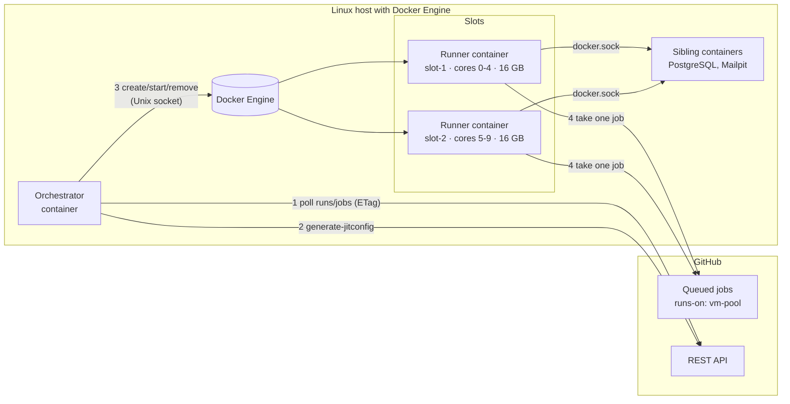

# Architecture

Status: implemented through phase 3 ([proof of concept](proof-of-concept.md),
[operations](operations.md)): GitHub App credentials, demand polling, repository guard with a
reloadable list, fair slot planning, launch, idle timeout, orphan sweep both ways, removal of
finished runners, and the runner version watch. See [PLAN.md](../PLAN.md).

## What it does

GitHub only lets a personal account register a self-hosted runner on **one** repository.
The orchestrator turns one host's capacity into a pool for several repositories: when a
job asking for the pool's label is queued in an enabled repository, it creates a
just-in-time runner for that repository in a fresh container, the container runs that one
job, and it is destroyed.



## Components

| Component | Responsibility | Boundary |
|---|---|---|
| `DemandPoller` | Per enabled repository, count queued jobs whose labels the pool serves | `IGitHubRunnerApi` |
| `PoolState` | Rebuild the pool's view from containers labelled `orchestrator.managed=true` | `IContainerRuntime` |
| `Scheduler` | Pure function: slots + running containers + demand + now → create / remove actions | none (unit-tested) |
| `RunnerLauncher` | Generate the JIT configuration, create and start the container | both |
| `Reaper` | Idle-runner timeout, exited containers, orphan runners and containers | both |
| `RepositoryGuard` | Refuse a listed repository that is public, not owned by the configured trusted accounts, or not covered by the App installation | `IGitHubRunnerApi` |
| `GitHubAppCredentials` | Per-account JWT → installation token, validated identity, renewed before expiry | `IGitHubCredentialSource` |
| `InstallationRouter` | Qualified repository routing, independent caches and API budgets | `IGitHubRunnerApi` |

One cycle, every `PollInterval`:

1. Reload configuration if the file changed (repository list, slots, labels).
2. `PoolState` ← list managed containers; `RepositoryGuard` validates new repositories.
3. `DemandPoller` ← queued matching jobs per repository.
4. `Scheduler` decides; `Reaper` and `RunnerLauncher` act.
5. Log one summary line: slots busy/idle/free, demand per repository, rate-limit budget.

## Configuration

```jsonc
{
  "Orchestrator": {
    "Owner": "thiagoluga",
    "PollInterval": "00:00:20",
    "IdleRunnerTimeout": "00:10:00",
    "RunnerLabels": [ "vm-pool" ],
    "RunnerImage": "ghcr.io/thiagoluga/gh-runners-orchestrator-runner:2.338.2",
    "DockerSocket": "/var/run/docker.sock",
    "GitHubApp": { "AppId": 0, "PrivateKeyPath": "/run/secrets/github-app.pem" },
    "Slots": [
      { "Name": "slot-1", "Cpuset": "0-4", "Memory": "16g" },
      { "Name": "slot-2", "Cpuset": "5-9", "Memory": "16g" }
    ],
    "StatusPort": 0,             // 0 = off; the reference deployment sets 9464 (operations.md)
    "Host": "",                  // several hosts only (ADR 0013, operations.md)
    "PoolHosts": []
  }
}
```

The deployment reads this from `config/orchestrator.json` ([deploy/](../deploy/compose.yaml));
environment variables override it. The repository list is its own file, reloaded on change,
so enabling a repository never touches anything else:

```jsonc
{ "Repositories": [ { "Name": "thiagoluga/saas-foundry", "MaxConcurrent": 2 } ] }
```

The existing `Owner` format remains supported. For multiple accounts, replace `Owner`
with explicit `Accounts` owner/installation pairs; never configure both. One coordinator
still owns the global slots. See [multi-account.md](multi-account.md) for validation,
migration and rollback. Tokens, ETags and rate budgets are isolated per installation.

The App id is not secret. The private key path points at a file; the key itself is never
in configuration.

## Using the pool from a repository

1. Install the GitHub App on the repository.
2. Add the repository to the list file. The orchestrator reloads it on the next cycle.
3. In the repository, aim the jobs at the pool label. Repositories that use the
   `CI_RUNNER` variable pattern only change the variable:

   ```yaml
   runs-on: ${{ (vars.CI_RUNNER != '' && vars.CI_RUNNER != 'gh') && vars.CI_RUNNER || 'ubuntu-24.04' }}
   ```

Disabling is the reverse; jobs already running finish.

## Decisions

See [docs/adr/](adr/README.md).

## Multiple private Apps

See [multiple-apps.md](multiple-apps.md) for the App registry, explicit account bindings,
legacy configuration compatibility, key mounts and deployment/rollback approval gates.
The original App can remain private; do not change its visibility for this option.
